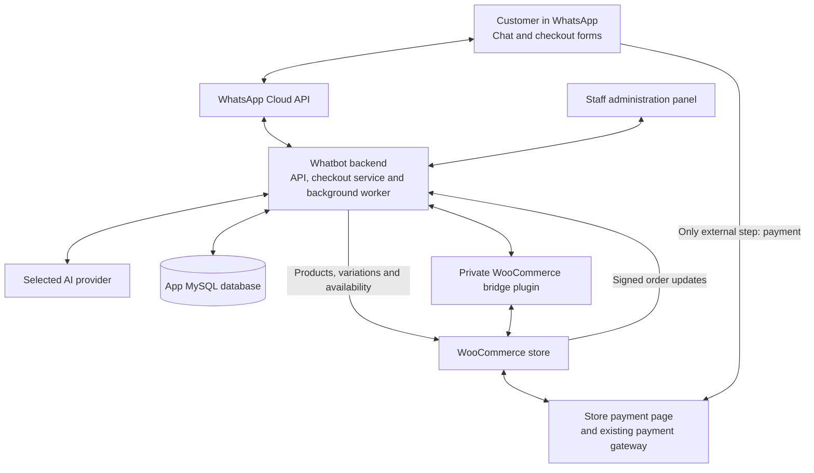
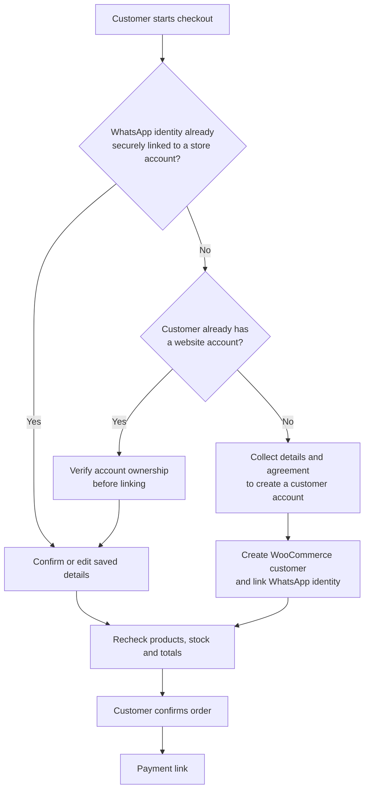

# Whatbot Convo: Bot Architecture and Customer Conversation Flow

**Document date:** 29 October 2026  
**Intended store:** https://sastrybalm.in  
**Status:** Core implementation available in demo mode. Live integrations and production acceptance are pending. Customer account creation, secure account linking and returning-customer convenience features remain to be implemented.

## 1. Customer experience

WhatsApp is the customer interface. Whatbot manages the conversation and checkout, while WooCommerce supplies store information and processes orders.

Product selection, contact and delivery details, account creation/linking, order review and support should stay inside WhatsApp. **Payment is the only step that should open an external page.** Account-related steps in this intended experience are not yet implemented.

## 2. System architecture

The diagram shows the connections supported by the core architecture. The local deployment still uses demo adapters; live connections require configuration and testing.

### Component responsibilities

| Component | Responsibility |
| --- | --- |
| WhatsApp | Customer messages, product discussions, checkout forms and confirmations. |
| WhatsApp Cloud API | Deliver incoming messages and status events to Whatbot, and send replies, checkout Flows and approved templates. |
| AI assistant | Understand requests, ask follow-up questions, retrieve product information through approved tools and request human help. The current conversation policy supports English and Telugu. |
| Whatbot API and checkout service | Validate requests, control checkout progression, check order ownership, reject stale quotes and coordinate order creation. |
| Background worker | Process saved jobs, send queued replies, retry known failures and reconcile order/payment status. |
| WooCommerce bridge plugin | Calculate shipping, tax, discounts and totals; create pending orders; retrieve payment status for bridge-created orders. |
| WooCommerce | Own products, variations, stock, prices, orders and payment state. It should also own customer accounts and saved addresses once account handling is implemented. |
| App MySQL | Persist conversations, carts, checkout progress, order links, staff accounts, sessions, operational settings, audit history and queued work. |
| Staff panel | Let staff read conversations, take over, reply and review failures. Administrators manage integrations and operational settings. |

### Authority and data boundaries

- WooCommerce supplies commercial facts. The AI must not invent prices, stock, discounts or delivery availability.
- The AI cannot change prices, charge customers, issue refunds or mark orders paid. It can start a checkout form; the backend creates an order only after customer confirmation.
- Checkout form details pass through the checkout service rather than through AI tool arguments. This does not imply that personal information voluntarily typed into ordinary chat can never enter conversation history.
- API credentials remain in protected server configuration. They are not returned to the customer or exposed in browser code.
- Business records persist in MySQL. An unavailable database causes a failure rather than an automatic fallback to temporary memory.
- Payment happens through the store's existing payment page and gateway. The bot must not request card details or banking passwords.

## 3. Message and order processing

1. A customer sends a WhatsApp message.
2. Whatbot verifies the incoming callback and saves the message/event and processing job in MySQL. Duplicate delivery is detected.
3. The worker processes the job. The AI uses approved tools to retrieve product information, start checkout, check an authorized order or request a human operator.
4. Checkout opens as an encrypted WhatsApp Flow. The backend validates each screen and maintains the saved checkout state.
5. WooCommerce calculates a quote using current products, stock, tax, coupons and delivery options.
6. The customer reviews and confirms. The backend checks the quote again and creates or recovers the pending order associated with that checkout session.
7. Whatbot saves the order link and queues the canonical payment link for delivery through WhatsApp.
8. The customer opens the payment page and completes payment through the existing gateway.
9. Signed WooCommerce updates and periodic reconciliation cause Whatbot to retrieve the current store order. Payment confirmation is sent only after the required payment and order checks pass.
10. Staff can take over the conversation when requested or when processing requires review.

An ambiguous message-send result is recorded for review instead of being blindly resent. Notifications use approved templates when required by the configured messaging-window rules.

## 4. Customer question sequence

The following is suggested customer-facing wording. Opening chat replies are currently AI-generated, rather than a fixed menu or script. The checkout uses the four structured screens described in section 5.

| Step | What the bot asks or shows | What happens behind the scenes |
| --- | --- | --- |
| 1. Welcome | “Welcome to Sastry Balm. Would you like to shop, check an order, or speak to our team?” | Identify the request and route the conversation. |
| 2. Product | “Which product are you looking for?” | Search WooCommerce and show actual matching products. |
| 3. Variant | “Which available size or variant would you like?” | Ask only when the selected product has variations. |
| 4. Quantity | “How many would you like?” | Check availability and show the selected items. |
| 5. Contact details | “Please enter your full name and confirm your WhatsApp number.” | Prefill the number and require it to match the checkout's WhatsApp identity. Collect email where required. |
| 6. Delivery | “Where should we deliver your order?” | Collect address, city, state, country and PIN/postcode inside WhatsApp. |
| 7. Coupon | “Do you have a coupon code?” | Optional. WooCommerce determines whether the coupon applies. |
| 8. Review | “Please choose your delivery option and review your order total.” | Show items, discount, shipping, tax and final total from WooCommerce. |
| 9. Confirmation | “Do you confirm this order and total?” | Recheck the quote, then create one pending WooCommerce order. |
| 10. Payment | “Your order is ready. Use this secure link to pay.” | Open the store's payment page. This is the external step. |
| 11. Confirmation | “Payment verified for order #[number].” | Send only after the backend verifies the store's payment state. |

Customers can ask for a human operator at any point. Product and order answers must use retrieved store data, and order access must remain restricted to the authorized customer.

## 5. Current WhatsApp checkout screens

**Your selection → Contact details → Delivery address → Review your order**

| Screen | Current fields and actions |
| --- | --- |
| Your selection | Product summary and quantities. The current multi-item quantity input uses comma-separated values. Continue to contact details. |
| Contact details | Full name, prefilled WhatsApp number and email. Name and phone are required; email is currently optional in the form. |
| Delivery address | Address, optional address line 2, city, state code, country code, PIN/postcode and optional coupon. Country defaults to `IN`. |
| Review your order | Authoritative item/totals summary, available shipping methods and the required “I confirm this order and total” confirmation. |

The store's checkout rules may require email or other fields that are optional or absent in the current form. These requirements must be aligned and tested before live activation. The existing form labels are English; fully localized checkout forms are not established by the conversational English/Telugu policy.

If shipping or the quote changes, the customer must review the updated total and confirm again. Checkout sessions expire; an expired or stale session must not create an order.

## 6. Planned customer account handling

**This section describes required future behavior, not completed functionality.**

The current bridge creates guest orders. It does not create WooCommerce customer accounts, verify/link existing website accounts or prefill saved addresses. WooCommerce should remain the owner of customer accounts and saved delivery details.

For a new customer, collect the required information and agreement inside WhatsApp, then create a WooCommerce customer and establish a secure identity link.

For an existing website customer using WhatsApp for the first time, verify account ownership before linking or revealing saved information. A typed email address or billing phone alone must never grant account access. The verification and recovery method still needs design, implementation and testing; the diagram does not claim that this mechanism already exists.

## 7. Planned returning-customer conversation

Once secure account linking and saved-detail retrieval are implemented, a returning customer should be asked fewer questions:

1. “Would you like to buy again, browse products, or check an order?”
2. For a repeat purchase: “Would you like the same items and quantities?”
3. “Should we use your saved delivery address, or would you like to change it?”
4. “Here is today's total. Do you confirm?”
5. “Please use this link to pay.”

Reorders must recheck current prices, stock, tax, coupons and shipping. Never reuse an old order's total without recalculation. Customer confirmation is required before each new order.

The current implementation recognizes a WhatsApp conversation and can check that customer's linked assistant-created orders. This is not equivalent to a verified WooCommerce account link. The Orders panel does not import the store's complete historical order list.

## 8. Recovery and support paths

| Situation | Required customer experience |
| --- | --- |
| Product or variant unavailable | Explain the availability result and ask the customer to choose an available option. |
| Invalid or unsupported delivery details | Identify the problem and request corrected details. Do not guess an address or delivery rate. |
| Price, stock or shipping changes | Show the updated quote and request confirmation again. |
| Checkout expires | Explain that checkout expired and start a fresh session. |
| Payment remains unverified | Keep the order pending. A customer's claim or screenshot is not payment verification. |
| Customer requests another payment link | Check ownership and current payable status, then resend the existing order's valid link. Do not create a replacement order merely to retry payment. |
| Customer asks for a person | Pause conversational bot replies and route the conversation to staff. |
| Processing or delivery outcome is uncertain | Record the issue for review and avoid duplicate orders or blind message retries. |

## 9. Production status and references

The core application is locally tested, but authenticated store integration, actual WordPress/WooCommerce plugin compatibility, native WhatsApp Flow behavior and real staging payments remain pending. Account handling and returning-customer features above must be completed before claiming the full intended experience is available.

- [Current technical architecture](architecture.md)
- [WhatsApp checkout form definition](../flows/checkout.json)
- [Store connection guide](store-connection.md)
- [Production readiness and missing features](production-readiness.md)
- [Setup and staging](setup.md)
- [Acceptance evidence](uat.md)
- [Operations runbook](runbook.md)
